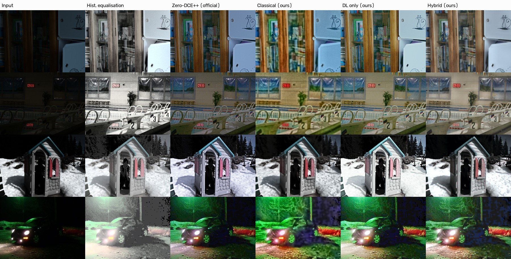

# 🌙 Lumina: adaptive low-light image restoration

**Computer Vision Hackathon 2026 · Problem P1: Robust Low-Light Image Restoration and Enhancement**

> *See what the dark hid, without inventing what wasn't there.*

**Live app:** https://darshuuuu-lumina-lowlight.hf.space  ·  **Code:** https://github.com/darshchandran/lumina-lowlight  ·  **Evaluation:** [`eval_P1_TXX.md`](eval_P1_TXX.md)  ·  **Design doc:** [`docs/DESIGN.md`](docs/DESIGN.md)  ·  **Architecture:** [`docs/ARCHITECTURE.md`](docs/ARCHITECTURE.md)

Lumina restores dark, noisy, colour-shifted photos with a **hybrid** of classical computer vision and two small neural networks. Every enhancement setting is chosen per image from measurements of that image, and the app explains in plain language what it noticed and what it did.



## Highlights

All test images are unseen (never used for training, validation or tuning). CPU only.

| Average over 3 paired test sets (215 pairs) | PSNR ↑ | SSIM ↑ | LPIPS ↓ | NIQE ↓ | Residual noise σ ↓ | ΔE2000 ↓ |
|---|---|---|---|---|---|---|
| Zero-DCE++ (official weights) | 17.13 | 0.654 | 0.281 | 6.84 | 5.07 | 16.33 |
| Classical only (ours) | 16.91 | 0.631 | 0.413 | 6.39 | 5.22 | 15.00 |
| Deep learning only (ours) | 18.04 | 0.642 | 0.287 | 6.95 | 6.43 | 13.98 |
| **Hybrid (ours)** | **18.50** | **0.794** | **0.229** | **4.18** | **1.22** | **12.15** |

- **LOL-v2 real (100 unseen pairs):** hybrid 20.11 dB / SSIM 0.822 / LPIPS 0.207, best on every metric.
- **ExDark real-world night photos (no ground truth):** hybrid has the best NIQE (4.16) and the lowest residual noise.
- **Two tiny networks:** 10.6k + 144.6k parameters (~0.6 MB); about 0.6 s per 600×400 image on a laptop CPU.
- Full tables, ablation, robustness sweep and failure analysis: [`results/tables.md`](results/tables.md), [`results/failures/`](results/failures/).

## How it works

```
photo ─► ① illumination map T (max-RGB + guided filter) + diagnosis (brightness, noise, lighting spread, colour cast)
        ─► adaptive parameters (no fixed strengths)
        ─► ② two candidates: Retinex re-lighting (classical) │ Zero-DCE++ fine-tuned (DL, quality-aware curve strength)
        ─► ③ per-pixel quality-weighted Laplacian-pyramid fusion + soft highlight roll-off
        ─► ④ adaptive CLAHE + colour correction
        ─► ⑤ restoration U-Net conditioned on a noise-level map derived from the illumination model
        ─► your intent (Natural / Auto / Max visibility + brightness slider)
```

Full diagram with function names: [`docs/ARCHITECTURE.md`](docs/ARCHITECTURE.md).

| Requirement | Implementation |
|---|---|
| Illumination estimation + decomposition, Retinex | `lowlight/classical.py`: `estimate_illumination`, `retinex_enhance`, `solve_gamma` |
| CLAHE, bilateral / guided-filter denoising, colour correction | `classical.clahe`, `classical.denoise`, `classical.colour_correct`, `protect_highlights` |
| Adaptive parameter selection | `lowlight/analysis.py`: `diagnose` → `choose_params` |
| Deep model (Zero-DCE++), fine-tuned | `lowlight/dce.py`, `scripts/train_dce.py` |
| DL restoration conditioned on classical illumination | `lowlight/restore.py`, `scripts/train_restore.py`, `pipeline.noise_map` |
| Adaptive selection / fusion, quality-aware strategy | `pipeline.fusion_weights`, `pyramid_blend`, `choose_dce_scale` |
| Classical vs DL vs hybrid, ablation, robustness, failures | `scripts/evaluate.py`, `scripts/report.py` → [`eval_P1_TXX.md`](eval_P1_TXX.md) |

## Human-centred design

- **Explains itself:** "What we noticed / What we did (and why)" in plain language, plus every intermediate map (illumination, gain, fusion weights, noise map, removed noise) in *Under the hood*.
- **Honest:** a *Recoverability* rating (High/Medium/Low) sets expectations; warnings for blown-out or still-grainy areas; a "magenta = pure white" clipping check.
- **No invented content:** curve and Retinex brightening are pixel-wise and monotone; the restorer predicts residual corrections only. No generative model.
- **User control:** *Natural night mood · Auto · Maximum visibility* presets plus a brightness slider.
- **Accessible and private:** phone camera capture, large touch targets, colour-blind-safe (cividis) heatmaps; images processed in memory and temp files purged within an hour.

## Run it

**One command (Docker):**
```bash
docker build -t lumina . && docker run -p 7860:7860 lumina
```
**Or with Python 3.10+:**
```bash
pip install torch --index-url https://download.pytorch.org/whl/cpu
pip install -r requirements.txt
python app.py
```
Open http://localhost:7860. The trained weights (~0.7 MB) are in `weights/`, so no download is needed to run the app.

## Reproduce training and every number in the evaluation

```bash
pip install -r requirements-dev.txt
python scripts/download_data.py          # LOL, LOL-v2 test splits, ExDark, Zero-DCE++ weights (~720 MB, to $DATA_DIR or ./data)
python scripts/train_dce.py              # Zero-DCE++ fine-tune on LOL train split (435/50 seeded split -> results/split.json)
python scripts/train_restore.py          # restoration U-Net (with noise-level map)
python scripts/train_restore.py --no-map # ablation model
python scripts/evaluate.py               # all methods x all test sets, ablation, robustness, latency (~20 min, 8 cores)
python scripts/report.py                 # results/tables.md, results/figures/, results/failures/
python -m pytest -q                      # tests
```
Everything runs on CPU, and seeds are fixed. The training logs we got are in `results/train_log_*.json`.

## Repository layout

```
app.py                  Gradio app (UI, validation, explanations)
lowlight/classical.py   classical CV primitives
lowlight/analysis.py    image diagnosis, adaptive parameters, plain-language explanations
lowlight/dce.py         Zero-DCE++ model
lowlight/restore.py     noise-aware restoration U-Net
lowlight/pipeline.py    methods (baselines, classical, DL, hybrid) + ablation switches
lowlight/metrics.py     PSNR, SSIM, LPIPS, NIQE, ΔE2000, EPI, noise, clipping
scripts/                download, train, evaluate, report
weights/                trained weights (+ official Zero-DCE++ weights)
results/                metrics, tables, figures, failure cases, training logs, split
docs/                   design document, architecture, in-app "About"
examples/               unseen test images used as demo examples (sources listed)
tests/                  pytest suite
```

## Limitations and ethics (short version)

Detail below the sensor noise floor cannot be recovered. Coloured lighting vs colour cast is ambiguous. Already-clipped highlights stay clipped. The networks were trained on LOL (indoor), so outdoor scenes rely more on the classical stages. **Outputs are for viewing, not evidence:** don't use them for identification or surveillance. Details: [`docs/DESIGN.md` §8–9](docs/DESIGN.md).

## Credits

Zero-DCE++ (Li, Guo & Loy, TPAMI 2021; official weights), LOL (Wei et al., BMVC 2018), LOL-v2 (Yang et al., TIP 2021), ExDark (Loh & Chan, CVIU 2019), LPIPS/NIQE via [pyiqa](https://github.com/chaofengc/IQA-PyTorch). The guided filter, CLAHE, Laplacian-pyramid blending and exposure-fusion weights are re-implemented from the original papers.
