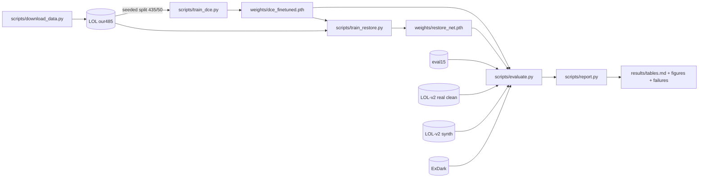

# Lumina — Adaptive Low-Light Image Restoration

**Computer Vision Hackathon 2026 · Problem P1:** Robust Low-Light Image Restoration and Enhancement  
**Team T76:** Indhu S (`1RUA24CSE0170`), Karthikeya D S (`1RUA24CSE0195`), Dheeraj Chinta (`1RUA24CSE0127`), Darsh Chandran (`1RUA24CSE0115`)

Hybrid classical CV + deep learning. Parameters are chosen per image from measured properties. No generative model — brightening is monotone / curve-based; the restorer predicts residual corrections only.

| | |
|---|---|
| Live app | https://lumina-t76.vercel.app |
| Engine + Gradio UI | https://darshuuuu-lumina-lowlight.hf.space |
| Code | https://github.com/darshchandran/lumina-lowlight |
| Evaluation (all numbers) | [`eval_P1_T76.md`](eval_P1_T76.md) |
| Design / requirements | [`docs/DESIGN.md`](docs/DESIGN.md) |
| Architecture | [`docs/ARCHITECTURE.md`](docs/ARCHITECTURE.md) |

**Jump to:** [Architecture](#system-architecture) · [Pipeline](#pipeline) · [Requirements → code](#requirements--code) · [Results](#results) · [Figures](#figures) · [Data](#dataset) · [Docs index](#documentation) · [Repo layout](#repository-layout) · [Run](#quick-start) · [Reproduce eval](#reproduce-training-and-evaluation) · [Limitations](#limitations)

---

## Deliverables

| Deliverable | Location |
|---|---|
| Deployed web app | [lumina-t76.vercel.app](https://lumina-t76.vercel.app) |
| Engine API + classic Gradio UI | [darshuuuu-lumina-lowlight.hf.space](https://darshuuuu-lumina-lowlight.hf.space) |
| Comparative evaluation | [`eval_P1_T76.md`](eval_P1_T76.md) · tables [`results/tables.md`](results/tables.md) |
| Ablation | [`eval_P1_T76.md` §6](eval_P1_T76.md) · [`results/figures/3_ablation.png`](results/figures/3_ablation.png) |
| Robustness (darkness sweep) | [`eval_P1_T76.md`](eval_P1_T76.md) · [`results/figures/2_robustness_illumination.png`](results/figures/2_robustness_illumination.png) |
| Failure cases | [`results/failures/`](results/failures/) · [`results/failures/index.md`](results/failures/index.md) |
| Design document | [`docs/DESIGN.md`](docs/DESIGN.md) |
| Frontend / API notes | [`docs/FRONTEND.md`](docs/FRONTEND.md) |
| Demo / viva notes | [`docs/DEMO_AND_VIVA.md`](docs/DEMO_AND_VIVA.md) |

---

## System architecture

Deployment and request path (from [`docs/ARCHITECTURE.md`](docs/ARCHITECTURE.md)):

```mermaid
flowchart TD
    U([User: phone / laptop browser]) -->|LUMINA web app on Vercel<br/>web/index.html + ui.js + lumina.js| API["api.py restore()<br/>POST /gradio_api/call/restore<br/>validation, cap ≤2048 px"]
    U -.->|classic interface / fallback| APP["app.py — Gradio UI"]
    API --> FULL["pipeline.run_full<br/>enhance at ≤1280 px, return input size"]
    APP --> FULL
    FULL --> RUN["pipeline.run(img, method, preset, strength)<br/>classical / dl / hybrid"]

    subgraph S1["1 Classical analysis — lowlight/classical.py, analysis.py"]
        T["estimate_illumination<br/>max-RGB + guided filter → T"]
        D["diagnose<br/>brightness, noise, lighting spread, cast,<br/>sharpness, edges, colourfulness, JPEG blocks, size"]
        PR["choose_params + solve_gamma<br/>adaptive γ, gain cap, CLAHE, WB, pre-denoise"]
        PD["pre_denoise<br/>chroma + 8×8 boundary deblock"]
        T --> D --> PR --> PD
    end

    subgraph S2["2 Brightening candidates"]
        RX["retinex_enhance<br/>I/T · T^γ gain-capped"]
        DC["Zero-DCE++ — lowlight/dce.py<br/>fine-tuned on LOL train split"]
        QA["choose_dce_scale<br/>quality-aware curve strength"]
        DC --> QA
    end

    subgraph S3["3 Adaptive fusion — pipeline.py"]
        FW["fusion_weights<br/>exposedness × contrast ÷ amplification"]
        PB["pyramid_blend<br/>Laplacian pyramid, 5 levels"]
        HG["protect_highlights<br/>soft-knee roll-off"]
        FW --> PB --> HG
    end

    subgraph S4["4 Contrast and colour — classical.py"]
        CL["clahe Lab L 16-bit"] --> CC["colour_correct<br/>partial gray-world + saturation"]
    end

    subgraph S5["5 DL restoration — lowlight/restore.py"]
        NM["noise_map<br/>σ after brightening × relative gain"]
        RN["RestoreNet U-Net 144579 params<br/>RGB + noise map → residual"]
        NM --> RN
    end

    RUN --> T
    PD --> RX & DC
    RX --> FW
    QA --> FW
    HG --> CL
    CC --> RN
    HG --> NM
    RN --> DR["6 recover_detail<br/>above-noise detail, halo clamp"]
    DR --> UI["adjust_exposure — user intent"]
    UI --> TRF["7 run_full detail transfer<br/>own fine band × gain"]
    TRF --> OUT([api.py JSON: classical + dl + hybrid WebP,<br/>diagnostics, maps, timings, Auto recommend])
```



Training / evaluation flow:



Hosted path: Vercel static frontend (`web/`) → Hugging Face Space Gradio engine (`app.py` + `api.py`), CPU inference. `Dockerfile` included for self-hosting. No database; temp files purged hourly. Details: [`docs/ARCHITECTURE.md`](docs/ARCHITECTURE.md), [`docs/FRONTEND.md`](docs/FRONTEND.md).

---

## Pipeline

| Method | Path in `pipeline.run` |
|---|---|
| Histogram equalisation (baseline) | `classical.histogram_equalize` |
| CLAHE only (baseline) | `classical.clahe` |
| Zero-DCE++ official (baseline) | published weights, no fine-tuning |
| **Classical only** | analysis (+ pre-denoise) → Retinex → highlight guard → gain-aware bilateral + guided denoise → CLAHE + colour + `limit_saturation` → `recover_detail` |
| **Deep learning only** | fine-tuned Zero-DCE++ alone |
| **Hybrid** | stages 1→6 in the diagram above; stage 7 when input > 1280 px |

Ablations (`pipeline.ABLATIONS`) remove one stage at a time on the same code path.

| Stage | Code |
|---|---|
| Illumination / Retinex | `lowlight/classical.py` — `estimate_illumination`, `retinex_enhance`, `solve_gamma` |
| Diagnosis / adaptive params | `lowlight/analysis.py` — `diagnose`, `choose_params`, `strategy`, `detail_strengths` |
| CLAHE, denoise, colour, highlights | `classical.clahe`, `denoise`, `colour_correct`, `protect_highlights`, `pre_denoise`, `limit_saturation`, `recover_detail` |
| Zero-DCE++ | `lowlight/dce.py`, `scripts/train_dce.py` |
| Fusion | `pipeline.fusion_weights`, `pyramid_blend`, `choose_dce_scale` |
| Noise-map restorer | `lowlight/restore.py`, `pipeline.noise_map`, `scripts/train_restore.py` |
| Full-size return / Auto | `pipeline.run_full`, `api.recommend` |
| Metrics / eval | `lowlight/metrics.py`, `scripts/evaluate.py`, `scripts/report.py` |

---

## Requirements → code

From [`docs/DESIGN.md` §3](docs/DESIGN.md) (problem statement mapping):

| Requirement | Implementation |
|---|---|
| Illumination estimation + Retinex | `classical.estimate_illumination`, `retinex_enhance`, `solve_gamma` |
| CLAHE | `classical.clahe` (Lab L, 16-bit, adaptive) |
| Edge-preserving denoising | `classical.denoise`, `pipeline.classical_denoise` |
| Contrast / colour correction | `clahe`, `colour_correct`, `protect_highlights` |
| Adaptive parameter selection | `analysis.diagnose` → `choose_params` |
| Low-light DL architecture + fine-tune | `dce.py` + `scripts/train_dce.py`; `restore.py` + `scripts/train_restore.py` |
| Classical illumination ↔ DL restoration | `pipeline.noise_map` → `RestoreNet` |
| Adaptive combine outputs | `fusion_weights` + `pyramid_blend` |
| Image-quality-aware enhancement | diagnosis → strategy / detail / DCE scale / pre-denoise / full-size transfer |
| Classical vs DL vs hybrid + ablation | `pipeline.METHODS`, `pipeline.ABLATIONS` → [`eval_P1_T76.md`](eval_P1_T76.md) |

---

## Results

All test images are unseen. LOL-v2 real is restricted to the **9 pairs** whose input and reference are not pixel-identical to LOL-v1 `our485` (86/100 inputs were duplicates; earlier all-100 numbers withdrawn — see [`eval_P1_T76.md`](eval_P1_T76.md)). CPU only. Numbers from `scripts/evaluate.py` / `scripts/report.py`.

### Summary (hybrid)

| | |
|---|---|
| Paired average (124 pairs, 3 sets weighted equally) | PSNR **18.19** dB · SSIM **0.769** · LPIPS **0.249** · NIQE **4.25** · noise σ **1.50** · ΔE2000 **13.36** |
| LOL-v1 eval15 | 19.13 dB / 0.777 / 0.207 |
| LOL-v2 real (clean 9) | 18.65 dB / 0.770 / 0.283 |
| LOL-v2 synthetic | 16.80 dB (DL-only better: 18.04) |
| ExDark (no reference) | residual noise **1.89** (best); NIQE 4.62 (official Zero-DCE++ 4.29) |
| Darkness sweep (30 refs × 6 conditions) | best in all six (×0.5 … ×0.025 + spotlight) |
| Latency (laptop CPU) | 808 ms @ 600×400 · 2194 ms @ 1280×960 · 2476 ms @ 2048 full-size (±25 % run-to-run) |
| Models | Zero-DCE++ 10,561 params (51 KB) · RestoreNet 144,579 params (575 KB) |
| Weak spots | LOL-v2 synthetic PSNR; new overexposure 1.11 % avg (highest of our methods) |

### Method comparison — paired average

| Method | PSNR ↑ | SSIM ↑ | LPIPS ↓ | NIQE ↓ | Noise σ ↓ | ΔE2000 ↓ |
|---|---|---|---|---|---|---|
| Zero-DCE++ official | 16.16 | 0.595 | 0.337 | 7.41 | 5.06 | 18.06 |
| Classical only (ours) | 16.74 | 0.618 | 0.477 | 6.92 | 5.38 | 16.51 |
| Deep learning only (ours) | 17.65 | 0.589 | 0.349 | 7.58 | 6.62 | 15.22 |
| **Hybrid (ours)** | **18.19** | **0.769** | **0.249** | **4.25** | **1.50** | **13.36** |

Per-set tables, ablation, quality-aware before/after, and failure analysis: [`eval_P1_T76.md`](eval_P1_T76.md). Raw aggregates: [`results/tables.md`](results/tables.md), [`results/metrics.json`](results/metrics.json), [`results/per_image.csv`](results/per_image.csv).

---

## Figures


---

## Human-centred behaviour (in the app)

| Behaviour | Implementation |
|---|---|
| Plain-language explanation | `analysis` → “What we noticed / What we did” |
| Recoverability High/Medium/Low | diagnosis-derived rating |
| Intermediate maps | illumination, gain, fusion weights, noise map, removed noise |
| Intent presets | Natural · Auto · Maximum visibility + brightness slider |
| Auto method choice | `api.recommend` (keeps hybrid unless another output clearly better) |
| Privacy | in-memory processing; Gradio temp files purged within ~1 hour |

---

## Dataset

| Set | Use | Size |
|---|---|---|
| LOL-v1 `our485` | train 435 / val 50 (`results/split.json`, seed 0) | 485 pairs |
| LOL-v1 `eval15` | paired test | 15 |
| LOL-v2 real `Test` (clean) | paired test; excludes `our485` duplicates | 9 of 100 |
| LOL-v2 synthetic `Test` | paired test | 100 |
| ExDark 384 px (letterbox trimmed) | no-reference real night photos | 60 (seed 0) |
| Darkness sweep | 30 LOL-v2 synthetic refs × 6 degradations | 180 / method |

Download: `scripts/download_data.py`. Leakage note and withdrawn numbers: [`eval_P1_T76.md`](eval_P1_T76.md). Demo image sources: [`examples/SOURCES.md`](examples/SOURCES.md).

---

## Documentation

| File | Contents |
|---|---|
| [`eval_P1_T76.md`](eval_P1_T76.md) | Full evaluation, ablation, robustness, quality-aware update, failures |
| [`results/tables.md`](results/tables.md) | Auto-generated metric tables |
| [`results/failures/`](results/failures/) | Failure-case gallery |
| [`docs/DESIGN.md`](docs/DESIGN.md) | Goals, requirements traceability, method, data, ethics |
| [`docs/ARCHITECTURE.md`](docs/ARCHITECTURE.md) | Function-level diagrams, methods, train/eval/deploy |
| [`docs/FRONTEND.md`](docs/FRONTEND.md) | Vercel ↔ HF API, controls, CSP, limits |
| [`docs/DEMO_AND_VIVA.md`](docs/DEMO_AND_VIVA.md) | Demo script and viva points |
| [`docs/about_app.md`](docs/about_app.md) | In-app About copy |
| [`results/`](results/) | metrics, figures, train logs, validation experiments |

---

## Repository layout

<details>
<summary>Folders and files</summary>

```
web/                  LUMINA frontend (Vercel): index.html, ui.js, lumina.js, build.mjs
api.py                JSON API for the web frontend (all three pipelines in one call)
app.py                Gradio UI + registers the API
lowlight/
  classical.py        illumination, Retinex, CLAHE, denoise, colour, detail
  analysis.py         diagnose, choose_params, explanations
  dce.py              Zero-DCE++
  restore.py          noise-aware U-Net
  pipeline.py         methods + ablations
  metrics.py          PSNR, SSIM, LPIPS, NIQE, ΔE2000, EPI, noise, …
scripts/              download_data, train_dce, train_restore, evaluate, report, validate
weights/              dce_finetuned, restore_net, restore_net_nomap, zero_dce_pp_official
results/              metrics, tables, figures, failures, train logs, split
docs/                 DESIGN, ARCHITECTURE, FRONTEND, DEMO_AND_VIVA, about_app
examples/             unseen demo images
tests/                pytest (pipeline + API)
Dockerfile            self-host image (python:3.12-slim + CPU PyTorch)
```

</details>

---

## Quick start

```bash
pip install torch --index-url https://download.pytorch.org/whl/cpu
pip install -r requirements.txt
python app.py    # http://localhost:7860 — engine + Gradio UI
```

```bash
docker build -t lumina . && docker run -p 7860:7860 lumina
```

Weights (~0.7 MB) are in `weights/`; no extra download to run inference.

Frontend against a local engine:

```bash
cd web && LUMINA_API_BASE=http://127.0.0.1:7860 node build.mjs
python -m http.server 8080 --directory dist
```

Vercel: [`docs/FRONTEND.md`](docs/FRONTEND.md).

### Reproduce training and evaluation

```bash
pip install -r requirements-dev.txt
python scripts/download_data.py          # LOL, LOL-v2, ExDark, Zero-DCE++ weights (~770 MB)
python scripts/train_dce.py
python scripts/train_restore.py
python scripts/train_restore.py --no-map # ablation checkpoint
python scripts/evaluate.py               # ~20 min, 8 cores, CPU
python scripts/report.py                 # tables, figures, failures
python scripts/validate.py NAME '{...}'  # validation-only experiments
python -m pytest -q
```

CPU only; seeds fixed. Logs: `results/train_log_*.json`.

---

## Limitations

- Detail below the sensor noise floor cannot be recovered.
- Coloured lighting vs colour cast is ambiguous.
- Already-clipped highlights stay clipped; new overexposure ~1.11 % avg.
- Networks trained on LOL (indoor) + synthetic noise; outdoor / heavy JPEG lean on classical stages.
- Not best on LOL-v2 synthetic (DL-only wins PSNR/SSIM/LPIPS there).
- **Outputs are for viewing, not evidence** — not for identification or surveillance.

See [`docs/DESIGN.md` §8–9](docs/DESIGN.md), [`results/failures/`](results/failures/).

---

## Credits

Zero-DCE++ (Li, Guo & Loy, TPAMI 2021), LOL (Wei et al., BMVC 2018), LOL-v2 (Yang et al., TIP 2021), ExDark (Loh & Chan, CVIU 2019), LPIPS/NIQE via [pyiqa](https://github.com/chaofengc/IQA-PyTorch). Guided filter, CLAHE, Laplacian-pyramid blending and exposure-fusion weights re-implemented from their papers.

Computer Vision Hackathon 2026 · Team T76.
