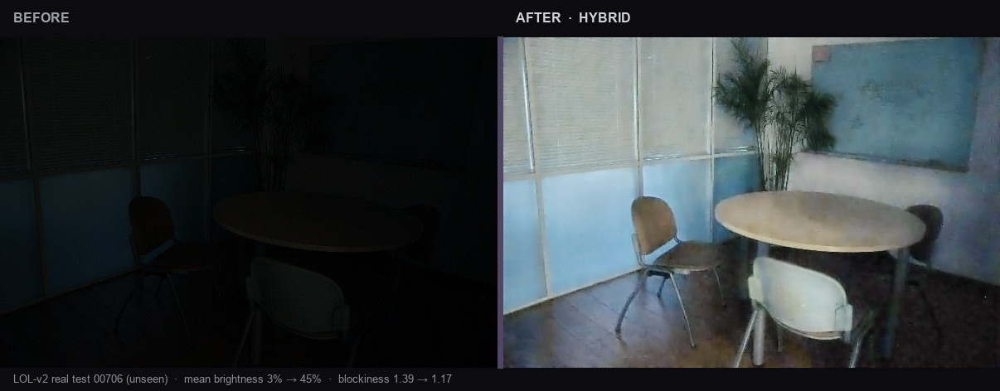
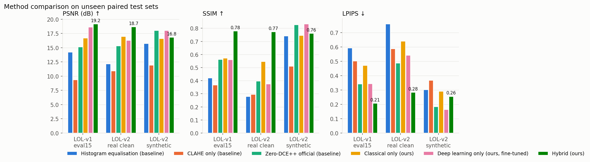
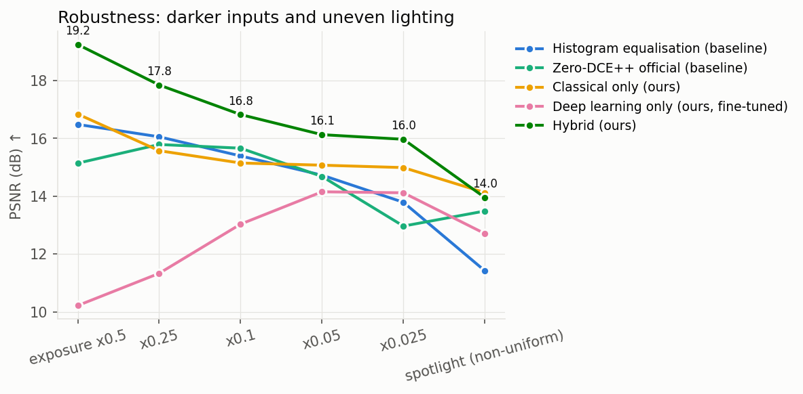
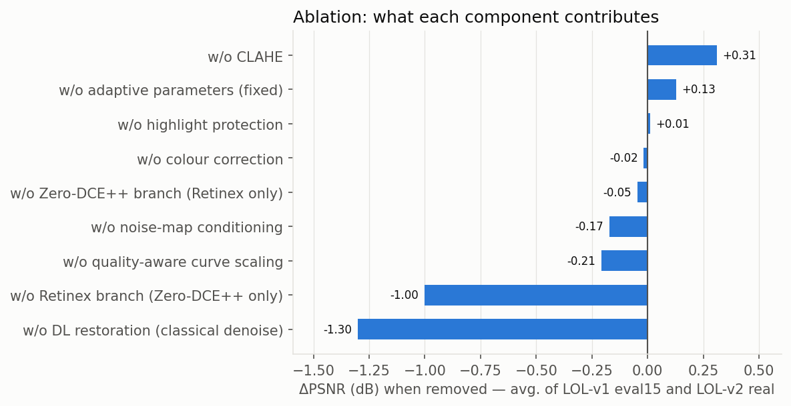
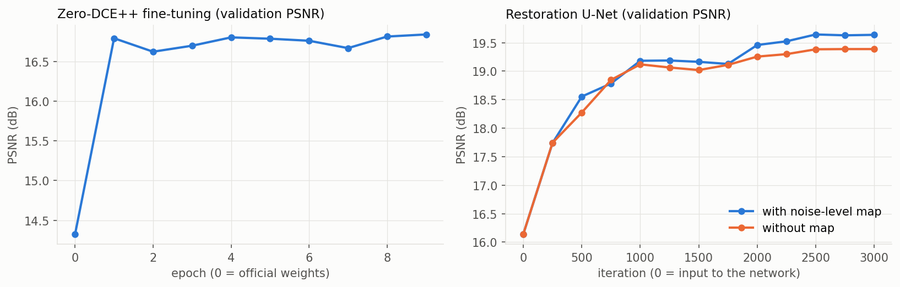
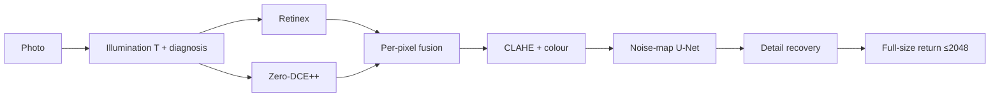

<div align="center">

# LUMINA

### See what the dark hid, without inventing what was not there.

**Adaptive low-light restoration** — classical computer vision + two small neural networks · **CPU only** · no generative model

[Live app](https://lumina-t76.vercel.app)
·
[Engine](https://darshuuuu-lumina-lowlight.hf.space)
·
[Evaluation](eval_P1_T76.md)
·
[Design](docs/DESIGN.md)
·
[Architecture](docs/ARCHITECTURE.md)

<br/>


<br/>



<sub>
<strong>Left:</strong> original at 3% mean brightness &nbsp;·&nbsp;
<strong>Right:</strong> Lumina hybrid at 45% &nbsp;·&nbsp;
blockiness 1.39 → 1.17 &nbsp;·&nbsp;
LOL-v2 real test <code>00706</code> (unseen) &nbsp;·&nbsp;
no generative model
</sub>

<br/>

Computer Vision Hackathon 2026 · Problem P1 · **Team T76**

</div>

---

## Summary

**The problem.** Brightening a dark photo also brightens its noise, blows out lamps, and amplifies JPEG blocks.

**Our answer.** Measure each photo first; pick every setting from those measurements. Fuse two brightening candidates (Retinex + fine-tuned Zero-DCE++) per pixel, then clean what brightening exposed with a small noise-aware U-Net.

**The result.** Best of six methods on **7 of 8** paired metrics — **18.19 dB** PSNR, **0.769** SSIM, **0.249** LPIPS — with **155,140** parameters (~0.6 MB) and no GPU.

**The honest part.** We lose on one test set, lose on one ExDark metric, and clip more highlights than the other methods. All of that is below and in [`eval_P1_T76.md`](eval_P1_T76.md).

---

## Try it

- **No install** — open [lumina-t76.vercel.app](https://lumina-t76.vercel.app), upload or pick a sample, press **Auto Enhance**
- **Local** — `pip install torch --index-url https://download.pytorch.org/whl/cpu` then `pip install -r requirements.txt` then `python app.py` → http://localhost:7860
- **Docker** — `docker build -t lumina . && docker run -p 7860:7860 lumina` *(Dockerfile written; Python path is what we tested)*

Weights (~0.7 MB) are already in `weights/` — nothing else to download for inference.

---

## Deliverables

| What judges need | Where |
|:--|:--|
| Live web app | [lumina-t76.vercel.app](https://lumina-t76.vercel.app) |
| Engine + Gradio UI | [darshuuuu-lumina-lowlight.hf.space](https://darshuuuu-lumina-lowlight.hf.space) |
| Full evaluation + failures | [`eval_P1_T76.md`](eval_P1_T76.md) |
| Design / requirements | [`docs/DESIGN.md`](docs/DESIGN.md) |
| Architecture | [`docs/ARCHITECTURE.md`](docs/ARCHITECTURE.md) |
| Source | [`app.py`](app.py) · [`api.py`](api.py) · [`lowlight/`](lowlight/) · [`web/`](web/) |

<details>
<summary><strong>Full inventory</strong> — code, scripts, results, weights</summary>

<br/>

| Category | Item | Link |
|:--|:--|:--|
| App | Engine entry | [`app.py`](app.py) |
| App | JSON API | [`api.py`](api.py) |
| App | Frontend | [`web/`](web/) |
| Docs | Frontend notes | [`docs/FRONTEND.md`](docs/FRONTEND.md) |
| Docs | Demo / viva | [`docs/DEMO_AND_VIVA.md`](docs/DEMO_AND_VIVA.md) |
| Classical | Illumination, Retinex, CLAHE, filters, colour | [`lowlight/classical.py`](lowlight/classical.py) |
| Classical | Diagnosis + adaptive params | [`lowlight/analysis.py`](lowlight/analysis.py) |
| DL | Zero-DCE++ | [`lowlight/dce.py`](lowlight/dce.py) |
| DL | Noise-aware U-Net | [`lowlight/restore.py`](lowlight/restore.py) |
| Hybrid | Fusion, noise map, methods | [`lowlight/pipeline.py`](lowlight/pipeline.py) |
| Metrics | PSNR, SSIM, LPIPS, NIQE, ΔE, EPI, noise | [`lowlight/metrics.py`](lowlight/metrics.py) |
| Train | DCE / restore / download | [`scripts/train_dce.py`](scripts/train_dce.py) · [`scripts/train_restore.py`](scripts/train_restore.py) · [`scripts/download_data.py`](scripts/download_data.py) |
| Eval | evaluate / report / validate | [`scripts/evaluate.py`](scripts/evaluate.py) · [`scripts/report.py`](scripts/report.py) · [`scripts/validate.py`](scripts/validate.py) |
| Results | metrics, tables, figures, failures | [`results/`](results/) |
| Models | Trained weights | [`weights/`](weights/) |
| Demo | Unseen examples | [`examples/`](examples/) |
| Tests | pytest | [`tests/`](tests/) |
| Setup | requirements + Dockerfile | [`requirements.txt`](requirements.txt) · [`Dockerfile`](Dockerfile) |

</details>

---

## Results

All test images are **unseen**. Averages over three paired sets (**124** pairs, sets weighted equally). CPU only. ↑ higher better for PSNR/SSIM; ↓ lower better for LPIPS/NIQE/noise.

| Method | PSNR ↑ | SSIM ↑ | LPIPS ↓ | NIQE ↓ | Noise σ ↓ | Latency @600×400 |
|:--|--:|--:|--:|--:|--:|--:|
| Zero-DCE++ (official) | 16.16 | 0.595 | 0.337 | 7.41 | 5.06 | 217 ms |
| Classical only (ours) | 16.74 | 0.618 | 0.477 | 6.92 | 5.38 | 193 ms |
| Deep learning only (ours) | 17.65 | 0.589 | 0.349 | 7.58 | 6.62 | 219 ms |
| **Hybrid (ours)** | **18.19** | **0.769** | **0.249** | **4.25** | **1.50** | 808 ms |

**Where hybrid does not win**

- **LOL-v2 synthetic:** DL-only better (18.04 vs 16.80 dB)
- **ExDark:** official Zero-DCE++ better NIQE (4.29 vs 4.62); hybrid still lowest noise (1.89)
- **Overexposure:** hybrid has the most new clipping of our methods (1.11% avg)
- **Speed:** ~4× slower than either single method (808 vs ~200 ms)

Per-set tables, ablation, darkness sweep, failures → [`eval_P1_T76.md`](eval_P1_T76.md) §§2, 4, 6, 8 · raw tables [`results/tables.md`](results/tables.md)

<p align="center">
  
  
</p>

<details>
<summary>More figures — robustness, ablation, training</summary>

<br/>

<p align="center">
  
  
  
</p>

</details>

---

## Data and validation split

| Set | Type | n | Used for |
|:--|:--|--:|:--|
| LOL-v1 `our485` train | real pairs | 435 | Training (`results/split.json`, seed 0) |
| LOL-v1 `our485` held-out | real pairs | 50 | Validation / model selection only |
| Synthetic dark pairs | darkened training refs | 435 | RestoreNet training |
| LOL-v1 `eval15` | real pairs | 15 | Test |
| LOL-v2 real, clean subset | real pairs | 9 of 100 | Test |
| LOL-v2 synthetic | synthetically darkened | 100 | Test |
| ExDark | real night, no reference | 60 | Test (no-reference metrics) |
| Darkness sweep | 30 refs × 6 conditions | 180 / method | Robustness |

**Leak found and fixed.** 86/100 LOL-v2 real test inputs are pixel-identical to LOL-v1 training images. We kept only the 9 clean pairs and withdrew earlier all-100 numbers. Details at the top of [`eval_P1_T76.md`](eval_P1_T76.md).

---

## How it works



| Stage | What happens |
|:--:|:--|
| 1 | Illumination map (max-RGB + guided filter) + measure brightness, spread, noise, sharpness, colour, JPEG blocks |
| 2 | Two candidates: Retinex re-lighting and Zero-DCE++ curves |
| 3 | Quality-weighted Laplacian-pyramid fusion + soft highlight roll-off |
| 4 | Adaptive CLAHE + colour correction |
| 5 | Restoration U-Net guided by a noise map from the illumination model |
| 6 | Recover detail only above the noise; return at the photo’s own size (≤2048 px) |

Every setting comes from measurements of *this* photo. Function-level map: [`docs/ARCHITECTURE.md`](docs/ARCHITECTURE.md).

| Pipeline | Idea | Strength | Weakness |
|:--|:--|:--|:--|
| Classical | Retinex, CLAHE, bilateral/guided, colour | Fast (193 ms), few new clips | Leaves noise (5.38) |
| Deep learning | Fine-tuned Zero-DCE++ | Natural brightening (219 ms) | Cannot denoise (6.62); amplifies JPEG |
| Hybrid | Fuse both, then noise-map U-Net | Best structure + noise (SSIM 0.769, σ 1.50) | Slower (808 ms); more clipping |

<details>
<summary>Tech stack</summary>

<br/>

| Layer | Tools |
|:--|:--|
| Language | Python 3.12 (3.10+), JavaScript frontend |
| Deep learning | PyTorch CPU · Zero-DCE++ · custom U-Net |
| Classical | OpenCV, NumPy (Retinex, guided filter, CLAHE, bilateral) |
| Metrics | scikit-image, pyiqa, custom ΔE2000 / EPI / noise |
| Engine | Gradio 6.31 · JSON endpoint · Hugging Face Space (CPU) |
| Frontend | Static HTML/CSS/JS · Node build · Vercel |
| Transfer | Data URL in · WebP out |
| Tests | pytest |
| Packaging | `requirements*.txt` · multi-stage `Dockerfile` |

</details>

---

## Known failures

| Case | What happened | Planned fix |
|:--|:--|:--|
| Brighter than reference (eval15 `179`, 12.68 dB) | Exposure target 0.42 is brighter than some references | Learn target from data |
| Coloured light neutralised (ExDark `2015_06796`) | Gray-world cannot tell one coloured lamp from a cast | Turn WB off when one source dominates |
| Dark on purpose (ExDark `2015_04779`) | Black studio lifted; blocks appeared | Low-key detector + gain-aware deblocking |
| Correlated colour noise (ExDark `2015_01791`) | U-Net trained on independent noise | Train on real compressed captures |

Full analysis with images: [`eval_P1_T76.md` §8](eval_P1_T76.md) · [`results/failures/`](results/failures/)

---

## Ethics, privacy and limits

Outputs are **for viewing only** — not for identification or surveillance. Uploads are processed in memory; temp files purged within an hour. Brightening is pixel-wise and monotone; the restorer predicts residual corrections only — **no invented content, no generative model**. Networks trained on LOL (indoor), so outdoor scenes lean on classical stages. We could not verify a licence for LOL / LOL-v2; Zero-DCE++ repo has no licence file though we reuse published weights. Detail below the sensor noise floor is not recovered, by design. More: [`docs/DESIGN.md` §8–9](docs/DESIGN.md).

---

## Reproduce everything

<details>
<summary><strong>Training and evaluation commands</strong></summary>

```bash
pip install -r requirements-dev.txt
python scripts/download_data.py          # LOL, LOL-v2, ExDark, Zero-DCE++ weights (~770 MB)
python scripts/train_dce.py              # Zero-DCE++ fine-tune (435/50 split)
python scripts/train_restore.py          # restoration U-Net v3
python scripts/train_restore.py --no-map # ablation model
python scripts/evaluate.py               # all methods × sets, ablation, robustness (~20 min)
python scripts/report.py                 # tables, figures, failures
python -m pytest -q
```

CPU only, fixed seeds. Latency varies up to ~25% between runs on the same laptop.

</details>

<details>
<summary><strong>Repository layout</strong></summary>

```
web/                  LUMINA web frontend (Vercel)
api.py                JSON API for the frontend
app.py                Gradio engine + classic UI
lowlight/             classical, analysis, dce, restore, pipeline, metrics
scripts/              download, train, evaluate, report, validate
weights/              trained + official Zero-DCE++ weights
results/              metrics, tables, figures, failures, train logs, split
docs/                 DESIGN, ARCHITECTURE, FRONTEND, DEMO_AND_VIVA
examples/             unseen demo images
assets/               README hero images
tests/                pytest suite
```

</details>

---

## Team

| Name | USN |
|:--|:--|
| Indhu S | 1RUA24CSE0170 |
| Karthikeya D S | 1RUA24CSE0195 |
| Dheeraj Chinta | 1RUA24CSE0127 |
| Darsh Chandran | 1RUA24CSE0115 |

### AI assistance

Our university allows AI use when acknowledged. Anthropic’s Claude (Claude Code agent) planned the system architecture (classical front-end, two brightening candidates, per-pixel fusion, noise-map-conditioned restoration, architecture diagram), wrote and debugged most of the source, ran training and evaluation, deployed the app, and drafted documentation. We set requirements and limits, chose among proposed options (e.g. hosting; restorer v3 over v2 on validation), provided the LUMORA v4 interface design, and we are responsible for the work and every claim in it.

### Credits

Zero-DCE++ (Li, Guo & Loy, TPAMI 2021) · LOL (Wei et al., BMVC 2018) · LOL-v2 (Yang et al., TIP 2021) · ExDark (Loh & Chan, CVIU 2019) · LPIPS / NIQE via [pyiqa](https://github.com/chaofengc/IQA-PyTorch). Guided filter, CLAHE, Laplacian-pyramid blending and exposure-fusion weights re-implemented from the original papers.

<p align="center"><br/><sub>Computer Vision Hackathon 2026 · Team T76</sub></p>
