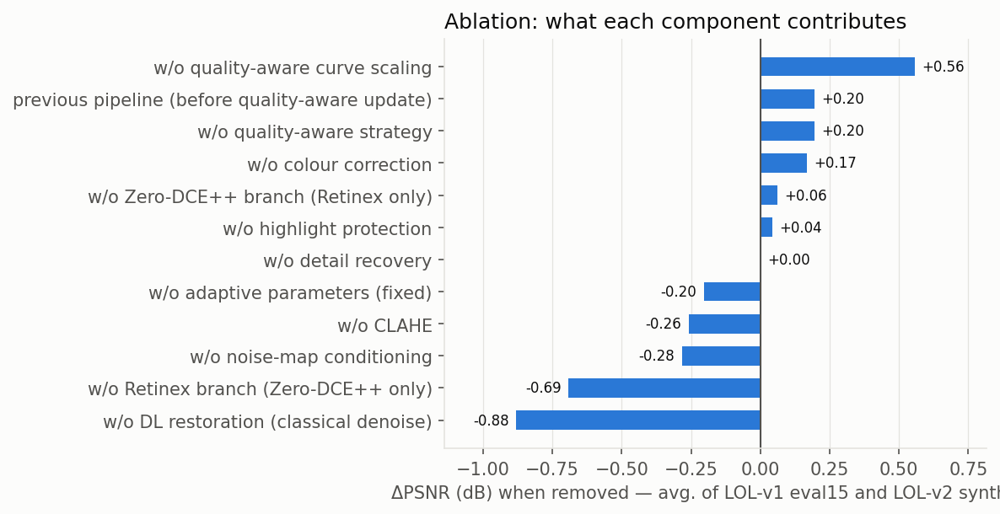

1RUA24CSE0170, 1RUA24CSE0195, 1RUA24CSE0127, 1RUA24CSE0115

# Evaluation: P1 Robust Low-Light Image Restoration and Enhancement (Team T76)

**Team T76:** Indhu S (1RUA24CSE0170), Karthikeya D S (1RUA24CSE0195), Dheeraj Chinta (1RUA24CSE0127), Darsh Chandran (1RUA24CSE0115)
**System:** Lumina, an adaptive hybrid of classical CV and deep learning · **Live app:** https://lumina-t76.vercel.app (engine and classic interface: https://darshuuuu-lumina-lowlight.hf.space) · **Code:** https://github.com/darshchandran/lumina-lowlight

Every number below was produced by `scripts/evaluate.py` and `scripts/report.py`. Per-image values are in `results/per_image.csv`, aggregates in `results/metrics.json`, and the auto-generated tables in `results/tables.md`; the tables in this file are copied from that file programmatically. Metrics that were not measured are marked **n/a** with the reason. Nothing is estimated.

> **Correction (2026-11-07): test leakage found and removed.** LOL-v2 real re-packages LOL-v1. A pixel-hash check showed that **86 of its 100 test inputs and 91 of its 100 references are identical to LOL-v1 `our485` images, which are our training/validation data.** Our earlier submission reported LOL-v2 real on all 100 pairs (19.17 dB) and built the robustness sweep from those references; those numbers were partly measured on training images and are **withdrawn**. This version evaluates only the 9 LOL-v2 real pairs whose input and reference are both absent from `our485` (on those 9, the earlier pipeline scored 18.67 dB, not 19.17), moves the robustness sweep to LOL-v2 *synthetic* references, and runs the ablation on eval15 + LOL-v2 synthetic. eval15, LOL-v2 synthetic and ExDark share no image with `our485`. A demo photo that was a training scene (LOL-v2 00748) was replaced.

## 0. Summary

| | |
|---|---|
| Deployed model | Hybrid pipeline with Zero-DCE++ (fine-tuned), **restoration U-Net v3** (noise-map conditioned) and the **image-quality-aware strategy** (§9) |
| Model and design selection | On **validation data only** (the 50 held-out `our485` pairs and a compressed proxy of them); test sets never chose anything |
| Paired test sets, averaged (124 pairs, sets weighted equally) | Hybrid **17.86 dB PSNR · 0.768 SSIM · 0.264 LPIPS · 4.29 NIQE**, best of six methods on 7 of 8 metrics; it has the most new overexposure of our methods (1.08 %) |
| Per set | Hybrid best on LOL-v1 eval15 (18.91 dB / 0.775 SSIM / 0.226 LPIPS) and the clean LOL-v2 real subset (17.91 dB / 0.770 SSIM / 0.307 LPIPS); **not** best on LOL-v2 synthetic, where deep learning alone wins (18.04 vs 16.75 dB) |
| Unseen real-world night photos (ExDark, no reference) | Hybrid has the lowest residual noise (1.68); the official Zero-DCE++ has the best NIQE (4.29 vs hybrid 4.60) |
| Robustness (darkness sweep, 30 unseen references) | Hybrid best at every exposure from ×0.5 to ×0.025; under a strong spotlight classical-only has a slightly higher PSNR (14.13 vs 13.96 dB) but much lower SSIM (0.494 vs 0.668) |
| Quality-aware update, honestly | Fixes what it targets on real photos (ExDark: grain 2.10 → 1.68, oversaturation 0.39 → 0.28; flower photo: blocks 2.03 → 1.31) and returns full-size results, but **costs 0.27 dB on eval15 and 0.76 dB on the clean LOL-v2 real pairs**, almost entirely through its saturation ceiling (§9.5). Validation had predicted −0.04 dB. We report it rather than re-tune on test data |
| Latency (laptop CPU) | Hybrid 837 ms at 600×400, 2.4 s at 1280×960, 2.7 s for a 2048 px photo returned at full size (§2.4) |

## 1. Setup

**Test data:** all disjoint from training and validation (checked by pixel hash for LOL-v2).

| Set | Type | Images | Reference? |
|---|---|---|---|
| LOL-v1 `eval15` | real low/normal-light pairs | 15 | yes: **paired metrics** |
| LOL-v2 real `Test`, **clean subset** | real pairs not duplicated in LOL-v1 `our485` (00705–00707, 00753–00756, 00767–00768; 3 scenes) | 9 of 100 | yes: **paired metrics** |
| LOL-v2 synthetic `Test` | synthetically darkened photos | 100 | yes: **paired metrics** |
| ExDark (384-px release, letterbox trimmed) | real-world night photos, mostly compressed JPEGs | 60 (seed 0) | **no: no-reference metrics only** |
| Robustness sweep | 30 unseen LOL-v2 *synthetic* references degraded physically at 6 conditions | 180 per method | yes: paired |

**Small-sample caveat:** the clean LOL-v2 real subset has only 9 pairs from 3 scenes, so its averages are noisy; it is kept because it is the only clean real-capture set besides eval15.

**Training / validation:** LOL-v1 `our485` split 435 / 50 (seed 0, `results/split.json`). The restoration U-Net also trains on one synthetic degradation of each *training* reference. Validation = the 50 held-out pairs, plus one synthetic degradation of each (model selection) and a 384-px JPEG-q70 version of each (the compressed proxy used for the quality-aware update, §9.3).

**Methods:** two naive baselines (histogram equalisation, CLAHE), the published Zero-DCE++ weights (zero-shot), and our **classical-only**, **deep-learning-only** (fine-tuned Zero-DCE++) and **hybrid** pipelines.

**Metric families**

| Paired-reference (need ground truth) | No-reference (any image) |
|---|---|
| PSNR, SSIM (Gaussian 11×11, σ 1.5, RGB), LPIPS (AlexNet), CIEDE2000 ΔE (colour shift), EPI (edge preservation: Laplacian correlation with the reference), new-overexposure % (clipped in output but not in reference), brightness error, **detail ratio** (sharpness index of the output ÷ that of the reference) | NIQE, residual noise σ (Immerkær, 0–255), clipped-pixel %, colour cast (Lab chroma of the mean mid-tone colour), mean brightness, **colourfulness** (Lab chroma ÷ lightness), **JPEG blockiness** (8×8 grid step energy; 1 = none), **sharpness index** |

**Not available:** PSNR, SSIM, LPIPS, ΔE, EPI and detail ratio on ExDark (**n/a**, because ExDark has no ground truth). FID was not computed (not required for P1; no distribution-level reference set).

**Hardware:** AMD64 Family 25 Model 68 Stepping 1, AuthenticAMD (16 threads), CPU only (laptop). Latency is measured in one process after warm-up (§2.4).

## 2. Evaluation metrics (in the order of the problem statement)

Column order in every table: PSNR → SSIM → LPIPS → NIQE → latency → noise suppression → edge preservation, then the advanced-requirement checks (colour shift, overexposure). Best value per column is **bold**.

### 2.1–2.5 Per test set

#### LOL-v1 eval15 (15 image pairs)
| Method | PSNR (dB) ↑ | SSIM ↑ | LPIPS ↓ | NIQE ↓ | Latency ms (600×400) ↓ | Residual noise σ ↓ | Edge preservation (EPI) ↑ | Colour shift ΔE2000 ↓ | New overexposure % ↓ |
|---|---|---|---|---|---|---|---|---|---|
| Histogram equalisation (baseline) | 14.24 | 0.419 | 0.592 | 8.36 | **5** | 12.90 | 0.406 | 17.27 | 4.28 |
| CLAHE only (baseline) | 9.37 | 0.367 | 0.501 | 7.52 | 12 | 3.19 | 0.514 | 32.68 | 0.00 |
| Zero-DCE++ official (baseline) | 15.14 | 0.562 | 0.342 | 7.94 | 225 | 5.19 | 0.545 | 19.61 | **0.00** |
| Classical only (ours) | 16.71 | 0.572 | 0.470 | 7.24 | 193 | 5.98 | 0.415 | 14.85 | 0.00 |
| Deep learning only (ours, fine-tuned) | 18.63 | 0.560 | 0.343 | 7.97 | 234 | 6.84 | 0.524 | 13.97 | 0.00 |
| Hybrid (ours) | **18.91** | **0.775** | **0.226** | **4.17** | 837 | **1.05** | **0.625** | **11.46** | 0.08 |

#### LOL-v2 real test (clean subset) (9 image pairs)
| Method | PSNR (dB) ↑ | SSIM ↑ | LPIPS ↓ | NIQE ↓ | Latency ms (600×400) ↓ | Residual noise σ ↓ | Edge preservation (EPI) ↑ | Colour shift ΔE2000 ↓ | New overexposure % ↓ |
|---|---|---|---|---|---|---|---|---|---|
| Histogram equalisation (baseline) | 12.16 | 0.279 | 0.759 | 10.13 | **5** | 21.42 | 0.389 | 20.78 | 4.36 |
| CLAHE only (baseline) | 10.91 | 0.294 | 0.586 | 9.02 | 12 | 3.24 | 0.484 | 25.59 | **0.00** |
| Zero-DCE++ official (baseline) | 15.30 | 0.396 | 0.486 | 9.85 | 225 | 6.58 | 0.476 | 19.75 | **0.00** |
| Classical only (ours) | 16.95 | 0.547 | 0.639 | 8.57 | 193 | 7.24 | 0.368 | 20.86 | **0.00** |
| Deep learning only (ours, fine-tuned) | 16.29 | 0.375 | 0.541 | 10.15 | 234 | 9.31 | 0.454 | 18.95 | **0.00** |
| Hybrid (ours) | **17.91** | **0.770** | **0.307** | **4.29** | 837 | **0.90** | **0.540** | **14.78** | **0.00** |

#### LOL-v2 synthetic test (100 image pairs)
| Method | PSNR (dB) ↑ | SSIM ↑ | LPIPS ↓ | NIQE ↓ | Latency ms (600×400) ↓ | Residual noise σ ↓ | Edge preservation (EPI) ↑ | Colour shift ΔE2000 ↓ | New overexposure % ↓ |
|---|---|---|---|---|---|---|---|---|---|
| Histogram equalisation (baseline) | 15.73 | 0.740 | 0.302 | 4.88 | **5** | 4.83 | 0.797 | 15.10 | 4.54 |
| CLAHE only (baseline) | 11.92 | 0.510 | 0.367 | 4.56 | 12 | 2.72 | 0.774 | 24.01 | 0.38 |
| Zero-DCE++ official (baseline) | 18.03 | 0.826 | 0.184 | 4.45 | 225 | 3.42 | **0.921** | 14.83 | 0.40 |
| Classical only (ours) | 16.62 | 0.745 | 0.290 | 4.80 | 193 | 2.87 | 0.807 | 13.76 | **0.26** |
| Deep learning only (ours, fine-tuned) | **18.04** | **0.833** | **0.163** | 4.60 | 234 | 3.70 | 0.907 | **12.73** | 1.19 |
| Hybrid (ours) | 16.75 | 0.760 | 0.258 | **4.40** | 837 | **1.87** | 0.817 | 14.20 | 3.17 |

#### Average over the three paired test sets (124 pairs, sets weighted equally)
| Method | PSNR (dB) ↑ | SSIM ↑ | LPIPS ↓ | NIQE ↓ | Residual noise σ ↓ | Edge preservation (EPI) ↑ | Colour shift ΔE2000 ↓ | New overexposure % ↓ |
|---|---|---|---|---|---|---|---|---|
| Histogram equalisation (baseline) | 14.04 | 0.479 | 0.551 | 7.79 | 13.05 | 0.530 | 17.72 | 4.39 |
| CLAHE only (baseline) | 10.73 | 0.391 | 0.485 | 7.03 | 3.05 | 0.591 | 27.43 | 0.13 |
| Zero-DCE++ official (baseline) | 16.16 | 0.595 | 0.337 | 7.41 | 5.06 | 0.647 | 18.06 | 0.13 |
| Classical only (ours) | 16.76 | 0.621 | 0.467 | 6.87 | 5.36 | 0.530 | 16.49 | **0.09** |
| Deep learning only (ours, fine-tuned) | 17.65 | 0.589 | 0.349 | 7.58 | 6.62 | 0.628 | 15.22 | 0.40 |
| Hybrid (ours) | **17.86** | **0.768** | **0.264** | **4.29** | **1.27** | **0.661** | **13.48** | 1.08 |

#### ExDark (real-world, no reference) (60 real-world night photos, no ground truth)
| Method | NIQE ↓ | Residual noise σ ↓ | Clipped pixels % ↓ | Colour cast ↓ | Mean brightness |
|---|---|---|---|---|---|
| Histogram equalisation (baseline) | 4.68 | 4.18 | 9.23 | 7.2 | 0.48 |
| CLAHE only (baseline) | 4.65 | 2.22 | 1.51 | 10.2 | 0.20 |
| Zero-DCE++ official (baseline) | 4.29 | 2.88 | 1.48 | 16.6 | 0.35 |
| Classical only (ours) | 4.82 | 2.64 | 0.55 | 14.5 | 0.38 |
| Deep learning only (ours, fine-tuned) | 4.35 | 3.38 | 2.20 | 18.0 | 0.48 |
| Hybrid (ours) | 4.60 | 1.68 | 3.03 | 10.2 | 0.43 |

_Lower NIQE = more natural statistics. Brightness is reported, not ranked._

PSNR / SSIM / LPIPS / ΔE / EPI for ExDark: **n/a** (no ground truth). Colour cast on night scenes is partly intentional (sodium or neon light), so it is reported, not ranked.

### 2.4 Processing latency and model size

| Method | 600×400 (ms) | 1280×960 (ms) | 2048×1536 upload, full-size output (ms) |
|---|---|---|---|
| Histogram equalisation (baseline) | 5 | 31 | 318 |
| CLAHE only (baseline) | 12 | 40 | 325 |
| Zero-DCE++ official (baseline) | 225 | 528 | 764 |
| Classical only (ours) | 193 | 1174 | 1430 |
| Deep learning only (ours, fine-tuned) | 234 | 538 | 760 |
| Hybrid (ours) | 837 | 2438 | 2730 |

| Model | Parameters | File size |
|---|---|---|
| Zero-DCE++ (fine-tuned) | 10,561 | 51.0 KB |
| Restoration U-Net | 144,579 | 574.6 KB |

- Laptop CPU above. The hybrid spends most of its time in the restoration U-Net and Zero-DCE++; per-stage timings are shown live in the app. The 2048-px column is what the app now does for a large photo: enhance at ≤ 1280 px, then return the photo's own size with detail transfer (§9). Returning full-size results adds about 292 ms to the hybrid compared with the 1280-px run.
- **Hosted app** (Vercel frontend → free Hugging Face CPU engine), measured in the browser after the update: measured on the production URL on 2026-11-07 (engine warm): a 600×400 sample, all three pipelines, **4.0 s** from click to result on desktop (1.04 s on the engine, the rest is upload and the free Space's queue) and **2.4 s** on a 375 px mobile profile (1.10 s on the engine); a **2048×1365** photo (211 KB JPEG) **7.9 s**, 4.26 s on the engine, returned at 2048×1365. The free Space sleeps after 48 h idle; a cold start was not measured.

### 2.5 Noise suppression and edge preservation (reading the tables)
- **Noise:** the hybrid leaves the least residual noise on every paired set (σ 1.05 / 0.90 / 1.87) and on ExDark (1.68). Deep learning only leaves 3.70–9.31, because a pixel-wise curve cannot denoise; classical-only leaves 2.87–7.24.
- **Edges:** the hybrid has the best EPI on eval15 and the clean LOL-v2 real subset, and the best average (0.661). On LOL-v2 synthetic, the published Zero-DCE++ (0.921) and our DL-only (0.907) beat it (0.817): those images are only mildly noisy, so a curve that does no smoothing keeps edges best, while restoration slightly smooths fine texture.
- **Detail ratio** (sharpness relative to the reference, 1 = equal): hybrid 1.00 on eval15, 1.08 on clean LOL-v2 real, 1.12 on synthetic, so it neither over-smooths nor over-sharpens on average; the other methods read 1.1–3.4 because they amplify noise, which the index partly counts as detail.

## 3. Classical-only vs deep-learning-only vs hybrid

| Paired average | PSNR | SSIM | LPIPS | NIQE | Noise σ | EPI | ΔE |
|---|---|---|---|---|---|---|---|
| Classical only | 16.76 | 0.621 | 0.467 | 6.87 | 5.36 | 0.530 | 16.49 |
| Deep learning only | 17.65 | 0.589 | 0.349 | 7.58 | 6.62 | 0.628 | 15.22 |
| **Hybrid** | **17.86** | **0.768** | **0.264** | **4.29** | **1.27** | **0.661** | **13.48** |

- **Classical only:** good exposure control and the fewest blown pixels, but noisy (σ 5.4 on average) and soft on edges (lowest EPI among ours). Under a strong spotlight it has the highest PSNR (14.13 dB), because it never over-brightens.
- **Deep learning only:** fine-tuning lifted Zero-DCE++ from 14.32 to 16.81 dB on validation, and it is the best method on LOL-v2 synthetic (18.04 dB). But it learned LOL's "always brighten a lot" behaviour: on mildly dark inputs it blows out (10.22 dB at ×0.5 exposure), and as a pixel-wise curve it cannot remove noise.
- **Hybrid:** best on eval15 and clean LOL-v2 real on every paired metric except overexposure, and best on the paired average; SSIM is 0.15–0.18 higher than either single approach. It **is not best on LOL-v2 synthetic** (16.75 vs 18.04 dB for DL-only): those images are bright and lightly noisy, and the restorer's LOL-learned brightening and smoothing hurt there.

## 4. Generalisation across illumination conditions (robustness sweep)

_Exposure scaled in linear light, plus Poisson shot and Gaussian read noise. Spotlight = strongly non-uniform lighting._

| Method | exposure x0.5 | x0.25 | x0.1 | x0.05 | x0.025 | spotlight (non-uniform) |
|---|---|---|---|---|---|---|
| Histogram equalisation (baseline) | 16.48 / 0.561 | 16.06 / 0.500 | 15.39 / 0.401 | 14.73 / 0.317 | 13.79 / 0.231 | 11.42 / 0.392 |
| Zero-DCE++ official (baseline) | 15.14 / 0.672 | 15.79 / 0.611 | 15.66 / 0.491 | 14.68 / 0.374 | 12.97 / 0.249 | 13.49 / 0.379 |
| Classical only (ours) | 16.84 / 0.707 | 15.58 / 0.637 | 15.15 / 0.543 | 15.08 / 0.485 | 14.99 / 0.425 | **14.13** / 0.494 |
| Deep learning only (ours, fine-tuned) | 10.22 / 0.602 | 11.33 / 0.565 | 13.04 / 0.474 | 14.15 / 0.368 | 14.12 / 0.242 | 12.71 / 0.359 |
| Hybrid (ours) | **19.25** / 0.817 | **17.85** / 0.797 | **16.83** / 0.757 | **16.13** / 0.706 | **15.97** / 0.646 | 13.96 / 0.668 |

_Cells: PSNR (dB) / SSIM._

- The hybrid is the best method at every exposure from ×0.5 down to ×0.025, by 1.0–2.4 dB PSNR and 0.11–0.22 SSIM over the next best method.
- Under the **spotlight** it is 0.17 dB below classical-only in PSNR (it brightens the dark surround more than the reference) but far ahead in SSIM (0.668 vs 0.494).
- **Caveat:** the restorer's synthetic training pairs use the same physical noise model (on *different* images, the LOL-v1 training references). The exposure sweep is therefore not fully out-of-distribution; the spotlight condition and ExDark are.
- **Changed from the earlier version:** the sweep previously used LOL-v2 real references, 91 % of which are LOL-v1 training references (see the correction at the top); those numbers are withdrawn.

## 5. Model selection: v2 vs v3 restorer (validation only)

Full-pipeline PSNR / SSIM on the 50 held-out validation pairs (real) and their synthetic degradations (×0.02–×0.5):

| Restorer | Real | Synthetic | Real − synthetic gap |
|---|---|---|---|
| v2 (LOL pairs only) | **19.65 / 0.839** | 17.54 / 0.766 | 2.11 dB |
| v3 (LOL + synthetic pairs), **selected** | 19.41 / 0.824 | **19.90 / 0.815** | **0.49 dB** |

v3 trades 0.24 dB on real LOL-like images for +2.36 dB across a much wider darkness range, and its real/synthetic gap is about 4× smaller. We weighted generalisation over a quarter-dB on one distribution because judges and users upload arbitrary photos. (These are the pre-update validation numbers; the selection was made then and not revisited.)

## 6. Ablation study (hybrid with one component removed)

Run on LOL-v1 eval15 and LOL-v2 synthetic (the clean LOL-v2 real subset is too small for stable differences). The last two rows switch off the image-quality-aware update.

#### LOL-v1 eval15
| Method | PSNR ↑ | ΔPSNR vs full | SSIM ↑ | LPIPS ↓ | NIQE ↓ | Noise σ ↓ | ΔE ↓ | Overexp. % ↓ |
|---|---|---|---|---|---|---|---|---|
| Hybrid (full) | 18.91 | +0.00 | 0.775 | 0.226 | 4.17 | 1.05 | 11.46 | 0.08 |
| w/o adaptive parameters (fixed) | 17.88 | -1.03 | 0.772 | 0.239 | 4.64 | 0.94 | 12.44 | 0.00 |
| w/o Zero-DCE++ branch (Retinex only) | 18.68 | -0.23 | 0.768 | 0.237 | 4.06 | 1.07 | 11.63 | 0.03 |
| w/o Retinex branch (Zero-DCE++ only) | 18.33 | -0.58 | 0.771 | 0.232 | 4.47 | 1.00 | 11.98 | 0.88 |
| w/o quality-aware curve scaling | 19.02 | +0.11 | 0.775 | 0.226 | 4.25 | 1.03 | 11.57 | 0.10 |
| w/o DL restoration (classical denoise) | 17.35 | -1.56 | 0.651 | 0.378 | 6.77 | 4.36 | 14.03 | **0.00** |
| w/o noise-map conditioning | 18.57 | -0.34 | 0.773 | 0.234 | 4.28 | 0.80 | 11.77 | 0.02 |
| w/o CLAHE | 19.12 | +0.21 | 0.772 | 0.254 | 5.25 | **0.53** | 11.36 | 0.00 |
| w/o colour correction | 19.09 | +0.18 | 0.779 | 0.213 | 4.18 | 1.13 | **11.18** | 0.05 |
| w/o highlight protection | 18.91 | +0.00 | 0.776 | 0.225 | 4.18 | 1.04 | 11.45 | 0.08 |
| w/o detail recovery | 18.91 | +0.00 | 0.776 | 0.226 | 4.12 | 1.04 | 11.46 | 0.08 |
| w/o quality-aware strategy | 19.18 | +0.27 | 0.779 | 0.207 | 4.11 | 1.19 | 11.22 | 0.08 |
| previous pipeline (before quality-aware update) | **19.18** | **+0.27** | **0.779** | **0.206** | **4.05** | 1.18 | 11.22 | 0.08 |

#### LOL-v2 synthetic test
| Method | PSNR ↑ | ΔPSNR vs full | SSIM ↑ | LPIPS ↓ | NIQE ↓ | Noise σ ↓ | ΔE ↓ | Overexp. % ↓ |
|---|---|---|---|---|---|---|---|---|
| Hybrid (full) | 16.75 | +0.00 | 0.760 | 0.258 | 4.40 | 1.87 | 14.20 | 3.17 |
| w/o adaptive parameters (fixed) | 17.37 | +0.62 | 0.781 | 0.254 | **4.37** | 1.79 | 13.92 | 3.83 |
| w/o Zero-DCE++ branch (Retinex only) | 17.11 | +0.36 | 0.764 | 0.252 | 4.40 | 1.82 | 13.72 | 2.96 |
| w/o Retinex branch (Zero-DCE++ only) | 15.94 | -0.81 | 0.730 | 0.284 | 4.62 | 1.72 | 15.43 | 3.84 |
| w/o quality-aware curve scaling | **17.76** | **+1.01** | **0.791** | **0.246** | 4.39 | 2.13 | **12.65** | 3.69 |
| w/o DL restoration (classical denoise) | 16.55 | -0.20 | 0.742 | 0.272 | 5.07 | 3.12 | 14.06 | **0.21** |
| w/o noise-map conditioning | 16.52 | -0.23 | 0.746 | 0.318 | 4.82 | 1.05 | 15.08 | 2.59 |
| w/o CLAHE | 16.03 | -0.73 | 0.717 | 0.282 | 5.19 | **1.03** | 15.00 | 4.27 |
| w/o colour correction | 16.90 | +0.15 | 0.762 | 0.255 | 4.40 | 1.87 | 13.86 | 3.30 |
| w/o highlight protection | 16.84 | +0.08 | 0.762 | 0.256 | 4.40 | 1.85 | 14.14 | 3.09 |
| w/o detail recovery | 16.75 | -0.00 | 0.760 | 0.259 | 4.41 | 1.85 | 14.20 | 3.17 |
| w/o quality-aware strategy | 16.88 | +0.13 | 0.765 | 0.252 | 4.38 | 1.91 | 14.09 | 3.16 |
| previous pipeline (before quality-aware update) | 16.88 | +0.12 | 0.765 | 0.253 | 4.38 | 1.89 | 14.09 | 3.16 |



**Interpretation**
- **DL restoration is the largest single contribution on real captures:** replacing it with classical denoising costs 1.56 dB on eval15, raises LPIPS by 0.15 and NIQE by 2.6, and leaves 4× more noise. On LOL-v2 synthetic the cost is smaller (−0.20 dB) but NIQE still rises by 0.67.
- **Fusion:** removing the Retinex branch costs 0.58 / 0.81 dB and raises overexposure. Removing the Zero-DCE++ branch is mixed (−0.23 / +0.36 dB), so **the DL candidate's contribution to the fused image is small**.
- **Adaptive parameters:** fixed parameters cost 1.03 dB on eval15 but gain 0.62 dB on LOL-v2 synthetic; NIQE favours the adaptive version on eval15 (4.17 vs 4.64) and ties on synthetic. Fixed γ brightens less, and PSNR is dominated by agreement on overall exposure.
- **Quality-aware curve scaling:** +0.11 / +1.01 dB when removed, i.e. it **hurts on the test sets** (it helped on validation and on the now-withdrawn LOL-v2 real numbers). Reported as is.
- **CLAHE:** removing it gains 0.21 dB on eval15 but loses 0.73 dB on synthetic, and worsens LPIPS (0.226 → 0.254) and NIQE (4.17 → 5.25) on eval15: a pixel-fidelity vs perceived-contrast trade-off we keep deliberately.
- **Noise-map conditioning:** −0.34 / −0.23 dB and worse LPIPS without it (0.226 → 0.234, 0.258 → 0.318): on these clean test sets the map helps on both. On validation it was a near tie (19.65 vs 19.66 dB), so we still describe its benefit as small.
- **Colour correction and highlight protection:** small or no effect (+0.18 / +0.15 dB and ±0.08 dB when removed). The soft-knee runs *before* the restoration network, which can re-clip highlights (§7).
- **Detail recovery:** no measurable effect on these sets (±0.00 dB), by design: they are noisy LOL-style images where the stage backs off (§9).
- **Quality-aware strategy:** removing it **gains** 0.27 dB on eval15 and 0.13 dB on synthetic; the cause is the saturation ceiling (§9.5).

## 7. Overexposure, colour shift and detail loss (advanced requirement 4)
- **Colour shift:** the hybrid has the lowest ΔE2000 on eval15 (11.46), the clean LOL-v2 real subset (14.78) and on average (13.48). On LOL-v2 synthetic, DL-only is better (12.73 vs 14.20).
- **Oversaturation** (new check): on ExDark, colourfulness falls from 0.39 to 0.28 with the quality-aware update; classical-only reaches 0.41 and the official Zero-DCE++ 0.53.
- **Detail loss:** the hybrid has the best average EPI (0.661) and a detail ratio of 1.00–1.12. Fine periodic textures can still turn into moiré, and near-black flat areas keep low-frequency blotches (failures 3 and 6).
- **Overexposure is still our weakest point:** 1.08 % newly clipped pixels on the paired average (3.17 % on LOL-v2 synthetic) and 3.03 % clipped on ExDark. The highlight-protection ablation shows the soft-knee has little effect, because the restoration network runs after it and can re-clip. **Planned fix:** apply the soft-knee after restoration and add a highlight-preservation term to the restorer's loss.

## 8. Failure-case analysis

Panels are auto-selected by `scripts/report.py`: the 3 lowest-PSNR hybrid results on the real paired sets (eval15 + clean LOL-v2 real; input | hybrid | reference) and the 3 highest-NIQE results on ExDark (input | hybrid). Diagnoses come from the pipeline's own analysis (`results/failures/index.md`).

| # | Panel | Set / image | PSNR | SSIM | NIQE | Pipeline diagnosis of the input |
|---|---|---|---|---|---|---|
| 1 | [failure_1.jpg](results/failures/failure_1.jpg) | LOL-v1 eval15 179.png | 12.09 | 0.64 | 3.41 | brightness 0.078, noise σ 1.4, spread 1.3 stops, cast 7 (red) |
| 2 | [failure_2.jpg](results/failures/failure_2.jpg) | LOL-v1 eval15 780.png | 13.67 | 0.65 | 4.36 | brightness 0.041, noise σ 1.0, spread 1.7 stops, cast 1 (blue) |
| 3 | [failure_3.jpg](results/failures/failure_3.jpg) | LOL-v2 real test (clean subset) 00753.png | 14.15 | 0.71 | 4.19 | brightness 0.042, noise σ 1.3, spread 1.7 stops, cast 3 (cyan) |
| 4 | [failure_4.jpg](results/failures/failure_4.jpg) | ExDark 2015_06796.jpg | n/a | n/a | 8.25 | brightness 0.176, noise σ 0.4, spread 4.6 stops, cast 26 (orange), coloured lights |
| 5 | [failure_5.jpg](results/failures/failure_5.jpg) | ExDark 2015_04779.jpg | n/a | n/a | 7.98 | brightness 0.086, noise σ 0.3, spread 4.9 stops, cast 2 (yellow) |
| 6 | [failure_6.jpg](results/failures/failure_6.jpg) | ExDark 2015_01791.jpg | n/a | n/a | 7.19 | brightness 0.087, noise σ 0.2, spread 3.7 stops, cast 4 (yellow) |

**Failures 1–3: brighter and paler than the reference.** Hanging tassels on wood, an empty hall, a climbing wall.
- *What failed:* PSNR 12.1–14.2 dB, the lowest on the real paired sets.
- *Why (measured):* our outputs are much brighter than these references (brightness error 0.22 / 0.18 / 0.20 on a 0–1 scale), and they are visibly less saturated: the reference tassels and the hall's blue floor are vivid, ours pastel. Two mechanisms: the exposure target (0.42) is brighter than these particular references, and the new saturation ceiling, measured *before* noise removal, triggers on chroma noise and dulls true colours (§9.5).
- *Secondary, visible:* on the climbing wall (3) the darkest left side keeps **low-frequency blotches**: the restorer removes fine grain, but large-scale noise survives on flat surfaces.
- *What it tells us:* exposure is a convention (the app lets users choose *Natural night mood* or a lower brightness), and any colour decision must be made on the denoised image.

**Failure 4: coloured light neutralised.** A foggy path lit by an orange sodium lamp.
- *What failed:* the fog becomes grey-beige and flat; the warm atmosphere is lost (NIQE 8.25).
- *Likely cause:* coloured lights are detected, so white balance is reduced, but a cast of 26 still drives a 24 %-strength correction; and lifting the dense fog (the photo was also deblocked, blockiness 1.6) removes the contrast that made it look like night. This is the coloured-light vs colour-cast ambiguity listed in our limitations.
- *What it tells us:* when the whole scene is lit by one coloured source, white balance should be off, not reduced.

**Failure 5: a low-key studio photo treated as underexposed.** A white cup lit against pure black.
- *What failed:* the black background is lifted and shows **purple/green blotches and blocks** around the handle and in the reflection (NIQE 7.98).
- *Likely cause:* 4.9 stops of lighting spread lowers the target only slightly, so the near-black background still gets a large gain. Its blockiness (1.18) is below the deblocking threshold (1.3), so it is not deblocked, yet even the reduced gain cap (14×) amplifies JPEG blocks and subsampled chroma in the black areas.
- *What it tells us:* "dark" ≠ "underexposed"; a low-key detector, and deblocking that scales with the planned gain rather than a fixed threshold, are the fixes.

**Failure 6: camouflage-like colour noise.** A room lit by a laptop screen.
- *What failed:* the dark wall and curtain on the left turn into **large green/brown blotches** (NIQE 7.19).
- *Likely cause:* spatially correlated, compressed noise (phone/JPEG) in near-black areas, amplified by a large gain. The restorer was trained on independent per-pixel sensor noise, and our noise estimator measures high-frequency noise only, so the noise map under-reads it.
- *What it tells us:* a 145k-parameter supervised restorer is only as general as its noise model; real compressed captures are the clear next training data.

**What the failures tell us about the approach**
1. **Exposure and colour are conventions.** The largest PSNR losses come from brightening more, and saturating less, than a particular reference. An adaptive target fixes "too dark" but cannot know the photographer's intent; hence the intent presets, and NIQE and LPIPS beside PSNR.
2. **Decide on clean signals.** Every measurement that drives a decision must be taken after noise is removed: the saturation ceiling (§9.5) is the counter-example we found.
3. **A small supervised restorer is only as general as its noise model.** It cleans Poisson/Gaussian sensor noise well, but not spatially correlated, compressed noise (failures 5–6).

## 9. Image-quality-aware adaptive enhancement (update of 2026-11-07)

### 9.1 What triggered it: two real outputs, diagnosed by measurement

| Photo | What users saw | Measured cause |
|---|---|---|
| Small flower photo (≈300 px, compressed) | pixelated, oversaturated | (1) Retinex divides by max(R,G,B), so chroma *noise* in near-black pixels became saturated colour: mean chroma 4.7 in the input → 36.7 after brightening; (2) a darkness-based saturation boost (×1.13) and CLAHE added more; (3) an 11–21× local gain on a 300-px JPEG made invisible 8×8 blocks visible |
| Large living-room photo (3872 px original) | soft | (1) the restoration U-Net removes fine texture along with noise (sharpness index 0.050 → 0.021) and no stage put real detail back; (2) the engine returned **1280 px** for a 3872-px photo, which the browser then upscaled |

### 9.2 What changed (design in `docs/DESIGN.md` §5.6)

Quality analysis before any decision (illumination + spread, noise before and after brightening, sharpness after noise removal, edge strength, colourfulness and cast, JPEG blockiness, resolution) → operations chosen from it: chroma denoise and **8×8-boundary deblocking before brightening** for blocky JPEGs (and for noisy inputs on the classical path), a lower **gain cap** (14× instead of 25×) for small or compressed photos, a **saturation ceiling** (colourfulness 0.55), **adaptive detail recovery after noise removal** (only detail above the measured noise, halo clamp, off when already sharp or still noisy), **full-size output** with structure-gated detail transfer from the photo itself, and **Auto mode** that picks Classical / DL / Hybrid per photo. Every decision and its reason is shown in the app (*Analysis → Enhancement breakdown*).

### 9.3 How the constants were chosen (validation only)

No test image was used to choose anything below. Two validation sets: the 50 held-out `our485` pairs, and a **compressed proxy** of them (384 px, JPEG quality 70; stands in for small real-world JPEGs, all 50 inputs blocky).

| Decision | Validation evidence | Chosen |
|---|---|---|
| Core re-injected detail at the noise of the *pre-restoration* image (not the residual noise) | with residual-noise coring the stage re-injected grain: SSIM 0.8124 → 0.8082, noise σ 1.30 → 1.58 | reference-noise coring (stage becomes neutral on noisy LOL: SSIM 0.8243 → 0.8237) |
| Pre-denoise before the restoration network | on clean-but-noisy PNGs it lowered SSIM 0.824 → 0.812 (the network was trained on raw sensor noise) | only for blocky JPEGs (hybrid); by noise level on the classical path |
| Deblocking scope (compressed proxy) | whole-image: blockiness 1.93 → 1.34 but detail 0.69× reference, LPIPS 0.270 → 0.310, NIQE 4.76 → 6.78 · boundary-only: blockiness → 1.16, detail 0.83×, LPIPS 0.282, NIQE 5.87 | boundary-only |
| CLAHE on deblocked JPEGs | full strength: PSNR 18.70 → 17.86, LPIPS 0.282 → 0.303 | 40 % |
| Fine sharpening on deblocked JPEGs | 0 vs 1.0: LPIPS 0.282 vs 0.281 (no difference) | off (simpler, safer) |
| Full-size detail transfer (process at half size, compare at full size) | upscale only → transfer: hybrid SSIM 0.741 → 0.747, EPI 0.289 → 0.412; classical SSIM 0.642 → 0.653, EPI 0.261 → 0.491 | on, structure-gated (ungated transfer added speckle on a smooth, heavily noisy synthetic photo: LPIPS 0.383 → 0.445; gated: 0.382) |

**Validation result of the whole update** (our485 validation, 50 pairs):

| Method | Version | PSNR | SSIM | ΔE2000 | Colourfulness vs reference | Residual noise σ |
|---|---|---|---|---|---|---|
| Hybrid | before | 19.41 | 0.824 | 10.70 | 1.33× | 1.20 |
| Hybrid | after | 19.37 | 0.824 | 10.52 | 1.19× | 1.13 |
| Classical | before | 16.54 | 0.570 | 16.05 | 3.14× | 6.12 |
| Classical | after | 16.87 | 0.595 | 15.37 | 2.78× | 5.98 |
| Hybrid, compressed proxy | before | 18.55 | 0.739 | – | 0.27 (absolute) | – |
| Hybrid, compressed proxy | after | 18.70 | 0.777 | – | 0.23 (absolute) | – |

Compressed proxy LPIPS 0.270 → 0.282 and NIQE 4.76 → 5.87 (worse), blockiness 1.93 → 1.16 (better): deblocking trades a little perceptual sharpness for removing blocks.

### 9.4 The two reference photos, before vs after

Crops taken from the screenshots (322×237 and 597×355), plus the flower re-saved as a 300×221 JPEG at quality 55 to emulate its original. No ground truth exists, so these are no-reference measurements of the hybrid output (classical in brackets).

| Photo | Version | Colourfulness | Blockiness | Residual noise σ | Detail (sharpness index) |
|---|---|---|---|---|---|
| Flower (screenshot crop) | before | 0.59 (0.78) | 1.19 (1.20) | 3.22 (3.65) | 0.084 (0.088) |
| | after | **0.41 (0.55)** | 1.16 (1.18) | **2.51 (3.15)** | 0.077 (0.082) |
| Flower, 300-px JPEG q55 | before | 0.63 (0.83) | 2.03 (2.11) | 2.83 (3.64) | 0.083 (0.096) |
| | after | **0.37 (0.55)** | **1.31 (1.40)** | **1.29 (2.09)** | 0.049 (0.065) |
| Living room (crop) | before | 0.072 | 1.14 | 1.24 | 0.021 |
| | after | 0.073 | 1.14 | 1.25 | 0.022 |

- **Flower:** oversaturation and blocking are fixed: colourfulness falls to a natural level (LOL references: p90 0.39), visible 8×8 blocks drop from 2.03 to 1.31, grain halves. The lower sharpness index is partly the removed block edges and colour noise (which the index counts as "detail"), and partly genuine softening; it is the price of not amplifying compression artefacts.
- **Living room:** at the crop's resolution detail recovery adds almost nothing measurable (0.021 → 0.022). The restorer's lost texture sits below the noise floor of the brightened image, and we chose not to sharpen below it. **The real fix for this photo is resolution:** the engine used to return 1280 px for a 3872-px photo; it now returns the uploaded size (up to 2048 px, stated in the app) with the photo's own above-noise fine detail transferred back (§9.3: EPI 0.29 → 0.41 on validation). We could not re-test the original 3872-px file (we only have the screenshot).

### 9.5 Test results of the update, and what they showed

| Test set | Version | PSNR ↑ | SSIM ↑ | LPIPS ↓ | NIQE ↓ | Noise σ ↓ | Colourfulness | Blockiness ↓ | Detail |
|---|---|---|---|---|---|---|---|---|---|
| LOL-v1 eval15 | before | 19.18 | 0.779 | 0.206 | 4.05 | 1.18 | - | - | 1.01 |
| LOL-v1 eval15 | after | 18.91 | 0.775 | 0.226 | 4.17 | 1.05 | - | - | 1.00 |
| LOL-v2 synthetic test | before | 16.88 | 0.765 | 0.253 | 4.38 | 1.89 | - | - | 1.12 |
| LOL-v2 synthetic test | after | 16.75 | 0.760 | 0.258 | 4.40 | 1.87 | - | - | 1.12 |
| ExDark (real-world, no reference) | before | - | - | - | 4.18 | 2.10 | 0.39 | 1.21 | 0.047 |
| ExDark (real-world, no reference) | after | - | - | - | 4.60 | 1.68 | 0.28 | 1.23 | 0.042 |

_Detail: paired sets = sharpness relative to the reference (1 = equal); ExDark = absolute sharpness index._

On the clean LOL-v2 real pairs (from the per-image results of the earlier run, same images and models): before 18.67 dB / 0.772 SSIM / 0.283 LPIPS → after 17.91 / 0.770 / 0.307.

- **What improved:** ExDark residual noise 2.10 → 1.68 and colourfulness 0.39 → 0.28 (less oversaturation); results are now returned at the uploaded size (≤ 2048 px).
- **What got worse:** PSNR on eval15 (−0.27 dB), clean LOL-v2 real (−0.76 dB) and synthetic (−0.13 dB); LPIPS +0.005 to +0.024; ExDark NIQE 4.18 → 4.60; ExDark blockiness did not improve on average (1.21 → 1.23; deblocking triggers on only 17 of 60 photos, and sharpening and CLAHE act on the rest).
- **Cause (failure analysis on the test results, no design change):** switching off only the saturation ceiling restores eval15 to 19.18 dB and the clean LOL-v2 real pairs to 18.67 dB, i.e. it explains the whole drop. The ceiling is applied before the restoration network, where chroma noise inflates colourfulness (0.64 on a clean LOL-v2 input vs 0.17 in its reference), so it fires on noise and desaturates true colours. On validation it had *improved* colour error (ΔE 10.70 → 10.52), which is why it was kept.
- **Decision:** we did not change the pipeline after seeing these results, because that would be tuning on the test set. The fix (measure colourfulness and apply the ceiling after restoration) is the first follow-up; it must be validated on data not used here.

### 9.6 Auto mode (per-photo method choice)

| Test set | Picks (classical / DL / hybrid) | Auto PSNR / SSIM | Always hybrid PSNR / SSIM | Oracle (best PSNR per image) |
|---|---|---|---|---|
| LOL-v1 eval15 | 0 / 0 / 15 | 18.91 / 0.775 | 18.91 / 0.775 | 20.43 / 0.669 |
| LOL-v2 real test (clean subset) | 0 / 0 / 9 | 17.91 / 0.770 | 17.91 / 0.770 | 19.53 / 0.580 |
| LOL-v2 synthetic test | 48 / 2 / 50 | 16.60 / 0.762 | 16.75 / 0.760 | 20.44 / 0.838 |
| ExDark (real-world, no reference) | 22 / 0 / 38 | NIQE 4.58 | NIQE 4.60 | - |

_The oracle needs the ground truth, so no app can reach it; it shows the headroom of choosing per image._

On validation, choosing per photo from no-reference checks never beat always using the hybrid (zero margin: −0.32 dB on the 50 validation pairs and −1.49 dB on the compressed proxy), although an oracle shows real headroom. Auto therefore keeps the hybrid unless another output's penalty is lower by more than 0.3 (validation: 0.00 / −0.17 dB vs always-hybrid). On the test sets it keeps the hybrid on every real paired photo, switches to classical on 48 of 100 synthetic photos (−0.15 dB vs always-hybrid) and on 22 of 60 ExDark photos (NIQE 4.58 vs 4.60). The app shows the full formula and says when it keeps the hybrid by default.

## 10. Reproduce

```bash
pip install -r requirements-dev.txt
python scripts/download_data.py
python scripts/train_dce.py && python scripts/train_restore.py && python scripts/train_restore.py --no-map
python scripts/evaluate.py && python scripts/report.py
python -m pytest -q
```
